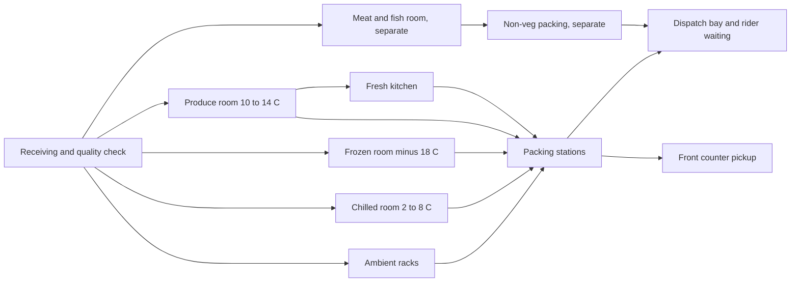

# 02. Store and operations

## Format: the neighborhood hub

One hub is three things under one roof:

1. A dark store (fulfillment only, laid out for picking speed).
2. A fresh kitchen (ready-made food, cut vegetables, batters).
3. A small front counter (order pickup, tasting, a visible fresh display that makes the brand real).

Planning size: 3,000 to 4,000 sq ft on a ground floor with two-wheeler parking and a loading bay. Service radius about 3 km. Both figures are assumptions to test against real rents and rider times in the chosen area.

## Layout

Layout rules:

- Fastest-moving items sit closest to packing. Slot positions are reviewed weekly from pick data.
- Vegetarian and non-vegetarian have separate storage, tools, packing, and bags, all color-coded.
- Every bin has a scannable location code. Pickers scan the bin and the item, so stock counts stay accurate without a nightly count.
- Every perishable batch has a received date and a use-by date in the system. Picking is first expired, first out.

## Fresh kitchen

- Licensed and run as a food production unit, separate from retail storage.
- Produces in small batches by daypart: breakfast items made before 6 am, lunch by 11 am, evening snacks by 4 pm, dinner by 6 pm.
- A production plan comes from the system each evening for the next day (see [04-ai-logic.md](04-ai-logic.md)). The chef can override it, and the override is recorded so the forecast learns.
- Fresh produce that is safe but past its display grade goes to the kitchen the same day (cut vegetables, soups, curries). This is the main lever against waste, and it runs under written food safety rules, never as a way to use unsafe stock.
- Every item carries a made-at time, a use-by time, an ingredient list, and an allergen note.

## Sourcing

| Category | Source | Rhythm |
|---|---|---|
| Vegetables and fruit | Farmer producer organizations and aggregators within about 150 km, plus the wholesale market as backup | Daily, early morning |
| Milk and dairy | One or two local dairies with test reports | Daily |
| Staples for private label | Mills and processors, packed by a contract packer | Weekly or fortnightly |
| Branded packaged goods | Distributors | Two or three times a week |
| Meat and fish | Licensed processors with cold chain | Daily |

Receiving is where trust is won or lost. Every inbound batch is weighed, graded, temperature-checked, and photographed in the staff app. Rejections are recorded per supplier, and supplier scorecards feed the reorder logic.

## Delivery model

- **On demand:** within 30 minutes inside the service radius.
- **Scheduled slots:** one-hour windows, used for big baskets.
- **Morning run:** subscriptions (milk, curd, bread, eggs, batter, fruit) delivered before 7 am, batched by building and tower. This is the cheapest delivery in the system and the strongest habit.
- **Gated community batching:** orders for the same community inside a short window ride together. Many communities restrict rider entry, so the app stores gate rules and tower drop points per community.

Riders: a small own team for peak hours and the morning run, with a logistics partner for overflow. Electric two-wheelers where charging is practical.

Packaging: paper and reusable crates, with a returnable crate deposit for the morning run. Insulated bags for chilled and frozen, with a cold pack for anything above a short ride.

## Staffing for one hub (planning assumption)

| Role | Count | Notes |
|---|---|---|
| Hub manager | 1 | Owns stock accuracy, waste, on-time rate |
| Shift leads | 2 | |
| Pickers and packers | 8 to 12 | Across two shifts |
| Receiving and quality | 2 | Early shift |
| Kitchen (chef plus helpers) | 4 to 5 | Starts 4 am |
| Riders (own) | 6 to 10 | Plus partner riders at peak |
| Customer support | 1 to 2 | Chat and phone, regional language |

## Operating metrics that matter

| Metric | Target to aim for |
|---|---|
| Fill rate (ordered items delivered as ordered) | Above 97 percent |
| On-time delivery | Above 95 percent |
| Fresh waste as a share of fresh sales | Below 4 percent |
| Stock accuracy | Above 98 percent |
| Pick time per order | Under 4 minutes |
| Complaints per 100 orders | Under 2 |

Targets are goals for the team, set from general retail practice, and should be reset after the first month of real data.
