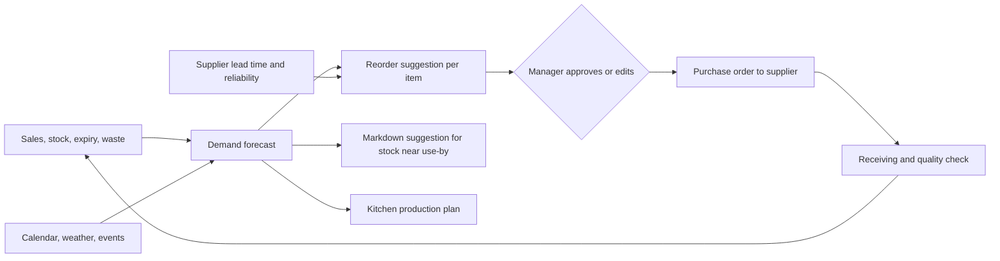

# 04. AI logic

Three engines: refill (stock and households), delivery, and the location-specific ready-made menu. All three share one demand forecast.

## Ground rules

1. **Rules first, models second.** A new hub has no history. Start with simple formulas a manager can read, and move to learned models once there are 8 to 12 weeks of clean data.
2. **A person approves anything that spends money or changes a price**, until the suggestion has earned trust on a measured track record.
3. **Every suggestion is logged with what was actually done and what happened.** Overrides are training data, not noise.
4. **Measure against a naive baseline** (same day last week). If the model cannot beat it, use the baseline.

## Shared demand forecast

Forecast unit: item, hub, day, and daypart (early morning, morning, afternoon, evening, night).

Signals:

| Signal | Why it matters in India |
|---|---|
| Day of week and daypart | Weekend cooking, weekday tiffins |
| Day of month | Salary week lifts staples and premium items |
| Festival and observance calendar, per region | Diwali, Sankranti, Ugadi, Ramzan, Navratri, Shravan, Ekadashi. Some lift sweets and dry fruit, some cut non-vegetarian demand sharply |
| Weather | Monsoon rain lifts fried snacks, tea, soups, and delivery orders, and slows riders |
| Local events | Cricket matches, school holidays, community events |
| Price and promotion | Own price changes |
| Stockouts | A sold-out day is not a zero-demand day. Correct for it or the forecast learns to under-order |
| Neighborhood profile | Share of families, diet mix, regional mix of the households served |

Stages:

1. **Week 0:** borrow category-level curves from the pre-order pilot and the manager's judgment.
2. **Weeks 1 to 12:** moving average by weekday and daypart, with manual multipliers for festivals and rain.
3. **After 12 weeks:** a gradient-boosted model per category using the signals above. Review error weekly by category.

## Engine 1a: store inventory refill

**Long shelf life items** (staples, packaged goods): reorder point.

- Reorder when stock on hand plus stock on order falls below expected demand during the supplier lead time, plus safety stock.
- Safety stock grows with forecast error and with how unreliable the supplier has been.
- Order quantity rounds to the supplier's case size and respects shelf space.

**Short shelf life items** (produce, dairy, bread, kitchen ingredients): order for the selling window.

- Order enough to cover forecast demand until the next delivery, weighed against shelf life.
- Compare the cost of running out (lost margin and a disappointed customer) with the cost of throwing away. Items where a stockout hurts trust (milk, onions, tomatoes) lean toward overstock. Costly, fragile items (berries, exotic vegetables) lean toward running out.

**Near use-by stock:** suggest, in order: move to the kitchen plan, mark down in the app for the last day, donate. The manager approves markdowns.

**Supplier scorecard:** on-time rate, rejection rate at receiving, and price drift feed back into which supplier the system suggests.

## Engine 1b: household refill

Goal: the customer opens the app and the likely basket is already there.

- For each household and each repeat item, track the gap between purchases and the quantity bought. The estimate of when they run out is the last purchase date plus the typical gap, scaled by quantity.
- Show the item on the refill card a little before the predicted run-out date.
- Households differ in size and habits, so the rhythm is learned per household. New customers start from the average for similar households.
- Respect signals: if the customer removes an item from the refill card twice, slow it down or stop.
- Subscriptions are the explicit version: daily milk, weekly fruit box, fortnightly staples.

Refill never places an order by itself. The customer confirms, or has set up a subscription with a clear schedule and an easy pause.

Household refill also sharpens Engine 1a: confirmed subscriptions and predicted refills are near-certain demand for tomorrow.

## Engine 2: delivery

| Decision | Logic |
|---|---|
| Promise shown to the customer | Live estimate from current queue, picker load, kitchen prep time for any hot items, rider availability, distance, rain, and gate delays for that community |
| Pick path | Order the pick list by bin location; pick chilled and frozen last |
| Kitchen timing | Start a made-to-order item so it finishes when picking finishes, not before |
| Batching | Combine orders going to the same community or tower within a few minutes, only if every order still meets its promise |
| Rider assignment | Nearest free rider who can meet the promise, balancing earnings across riders |
| Morning run routing | Fixed route by tower, rebuilt each night from the next day's subscriptions |
| Slot shaping | Offer a small incentive for slots where riders are idle; hide slots that are full |
| Staffing | Next week's picker and rider roster from the forecast by daypart |

Start with distance and simple time estimates. Add a learned travel-time model per community once delivery records build up, because the last 200 metres (gate, lift, tower) often takes longer than the road.

## Engine 3: location-specific ready-made menu

Each hub has its own menu, decided by where it is, what day it is, and what time it is.

Three layers:

1. **Regional base.** The city and state set the core menu.
2. **Neighborhood tuning.** The actual households served adjust it: share of vegetarian homes, mix of regional communities, office-goer versus family share.
3. **Day context.** Daypart, weather, festival, and what fresh stock needs using today.

Examples (illustrative, to be replaced by real sales data):

| Location | Breakfast | Lunch | Evening | Dinner |
|---|---|---|---|---|
| Hyderabad | Idli and dosa batter, pesarattu batter, upma mix, fresh chutneys | Pappu, vegetable fry, curd rice, biryani kit | Mirchi bajji kit, punugulu batter, Irani-style chai masala | Gongura dal, chicken curry base, phulka dough |
| Bengaluru | Ragi dosa batter, rava idli mix, chutney pudi | Bisi bele bath, mosaru anna, ragi mudde kit | Maddur vada, filter coffee decoction | Saaru, palya, akki rotti dough |
| Mumbai | Poha kit, thepla, misal base | Varan bhaat, bhaji, chapati | Vada pav kit, bhel kit | Pav bhaji base, usal, bhakri dough |
| Delhi NCR | Paratha dough and fillings, chole base | Rajma, dal makhani base, phulka | Samosa and chaat kits | Paneer gravies, tandoori marinades |

Day context examples: steady rain pushes a pakora kit and ginger tea to the top of the evening menu; Navratri switches the hub to a fasting menu (sabudana khichdi, kuttu atta items); a surplus of ripe tomatoes becomes rasam and tomato chutney.

How the menu is chosen each day:

1. Start with the hub's proven sellers per daypart.
2. Add one or two trial dishes, chosen to test a guess about the neighborhood. Keep what sells, drop what does not.
3. Size each batch from the daypart forecast, with small batches and a second batch on demand in place of one large batch.
4. Pull ingredients from stock that needs using first.
5. Show the menu only to customers of that hub, ordered by each household's diet and history.

Format mix, from least to most kitchen effort: cut and cleaned vegetables, batters and doughs, chutneys and pastes, meal kits with measured ingredients, curry bases, fully cooked dishes. Start at the low-effort end, where shelf life is longer and waste risk is lower.

## Where a large language model fits

Forecasting and routing are numeric problems and do not need one. A language model earns its place where the input or output is language:

- Meal to cart, recipe to cart, and voice ordering in regional languages.
- Search that understands regional names and loose descriptions.
- Plain-language ingredient and label summaries.
- A hub manager assistant: "why did we run out of curd yesterday?" answered from the logs.
- Drafting supplier messages and summarizing complaint themes.

Plan: Claude through Amazon Bedrock, using a small fast model for search and voice and a larger model for the manager assistant. Catalog facts (price, stock, ingredients) always come from the database through tools, never from the model's memory.

## Later ideas, not for launch

- Camera grading of produce at receiving.
- Dynamic pricing beyond end-of-day markdowns.
- Automatic purchase orders without approval for items with a long accurate track record.
