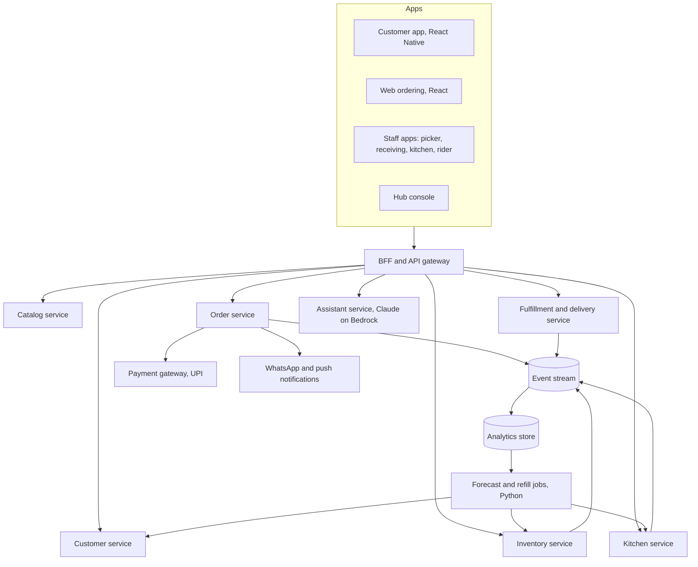

# 05. Architecture

## Where the repo stands today

- `grocery-ui`: React app with customer screens (login, register, product list, membership plans) and an admin dashboard.
- `java-microservices`: Spring Boot skeletons for product, user, and order services, plus a BFF.
- `grocery-bff`: a second BFF draft with product and user proxy controllers.
- `flyway-migrations`: one table each for products, users, and orders.
- `grocery-backend`: an older single-application skeleton.

This is a starting skeleton. The gaps below are what the India design needs first.

| Gap | Why it blocks the design |
|---|---|
| `products.stock` is one number | Stock must be per hub, per batch, with a use-by date |
| `orders` holds one product per row | A basket needs an order with many lines |
| No hub or address model | Everything (catalog, menu, promise) depends on which hub serves the address |
| No inventory movements | Refill logic needs receiving, picks, waste, and transfers as events |
| Email and password login | Indian customers expect phone number and one-time code |
| Two BFFs and an unused backend folder | Pick one BFF (`grocery-bff`) and remove the duplicates |

## Target shape

Keep the service count small at the start. Product becomes catalog, user becomes customer, order stays, and inventory is the one new service that is essential on day one. Fulfillment, delivery, and kitchen can live inside the order and inventory services until volume justifies splitting them. More services than engineers is a cost, not a feature.

## Core data model (additions)

| Table | Key fields | Purpose |
|---|---|---|
| `hubs` | id, name, city, location, service area, open hours | One row per hub |
| `addresses` | customer id, location, community id, hub id | Maps a customer to the hub that serves them |
| `communities` | name, gate rules, tower drop points | Gated community delivery details |
| `hub_products` | hub id, product id, price, active | Each hub has its own range and price |
| `stock_batches` | hub id, product id, batch, received at, use by, quantity, bin | Stock by batch with expiry |
| `stock_movements` | batch id, type (receive, pick, waste, transfer, adjust), quantity, time | The event log that every forecast reads |
| `orders` and `order_lines` | order header, then one row per item with substitution preference | Replaces the current single-row order |
| `subscriptions` | customer id, product id, schedule, paused until | Morning run and repeat orders |
| `purchase_orders` and `po_lines` | supplier, hub, expected date, status, suggested versus approved quantity | Refill suggestions and approvals |
| `suppliers` | lead time, case sizes, scorecard fields | Feeds reorder logic |
| `kitchen_items` and `production_plans` | dish, recipe, hub, daypart, planned and actual quantity | Location-specific menu |
| `forecasts` | hub, product, date, daypart, quantity, model version | Stored so accuracy can be measured |
| `quality_reports` | product or batch, lab, result, document link | Shown on the product page |

Product additions: unit and pack size, vegetarian or non-vegetarian mark, ingredient list, allergen list, tax code and rate, shelf life, storage zone, private label flag.

## Technology choices

| Area | Choice | Reason |
|---|---|---|
| Backend services | Java Spring Boot | Already in the repo |
| Database | MySQL with Flyway | Already in the repo; one schema per service |
| Forecast jobs | Python, run on a schedule | Standard tooling for forecasting |
| Mobile | React Native | Shares skills with the React web app |
| Search | Database search at launch, a search engine later | 1,000 items do not need a search cluster |
| Events | A managed queue at launch | Simple, cheap, enough for one hub |
| Payments | An Indian payment gateway with UPI | UPI is the default way to pay |
| Messaging | WhatsApp Business API and push | Where the customer already is |
| AI assistant | Claude on Amazon Bedrock, called through tools that read the database | Language tasks only |
| Maps | A maps provider with good Indian address and community data | Last 200 metres matters |

## AWS notes

- **Region.** Customers in India should be served from an Indian Region (Mumbai or Hyderabad) for speed, and to keep personal data handling simple under India's data protection law.
- **The current personal project cannot host production.** It is on the Free plan and locked to Ohio. It is fine for prototypes and demos. A production launch needs a project or account whose Region is in India, likely under the Indian business entity.
- **Launch footprint for one hub** should be small: a container service for the handful of services, one managed MySQL database, object storage and a content delivery network for images, a queue, and scheduled jobs for forecasts. Size it for a few thousand orders a day and grow from there.
- **Prototype path now:** build and run everything locally with Docker Compose (already in the repo), and deploy a demo to the personal project only when there is something to show.

## Build order

1. Fix the data model: hubs, addresses, hub products, stock batches and movements, orders with lines.
2. Phone login with a one-time code.
3. Customer flow end to end for one hub: browse, cart, pay, track.
4. Picker and receiving flows, so stock stays accurate.
5. Hub console: orders, stock, expiry alerts.
6. Subscriptions and the morning run.
7. Kitchen menu and production plan.
8. Rule-based refill suggestions, then the forecast jobs.
9. Assistant features (meal to cart, voice search).
